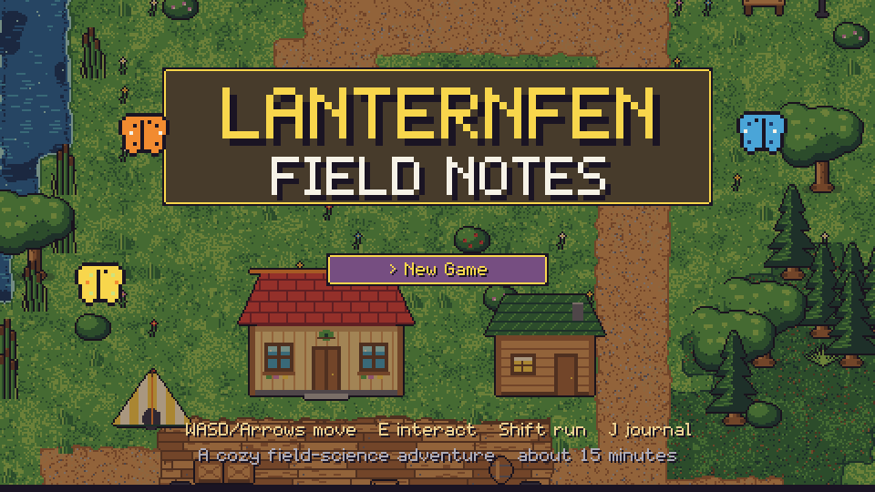
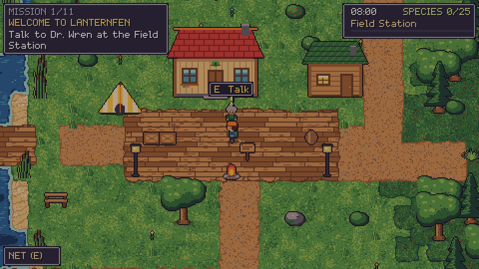
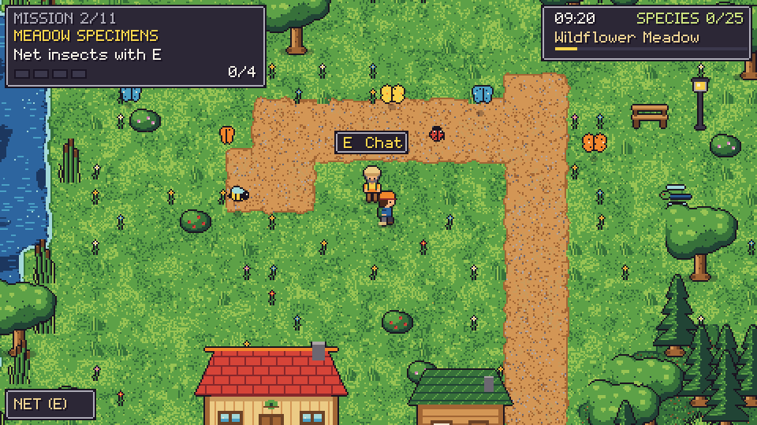
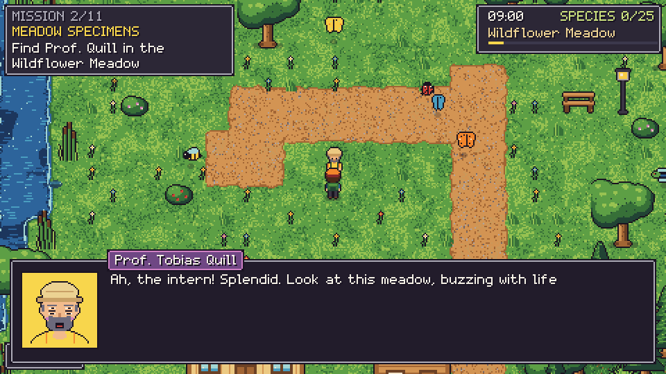
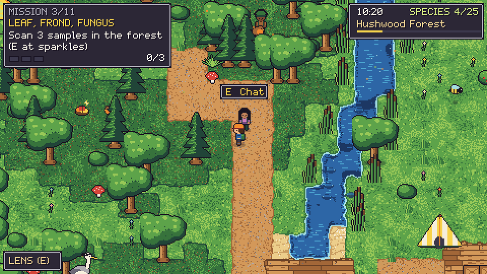
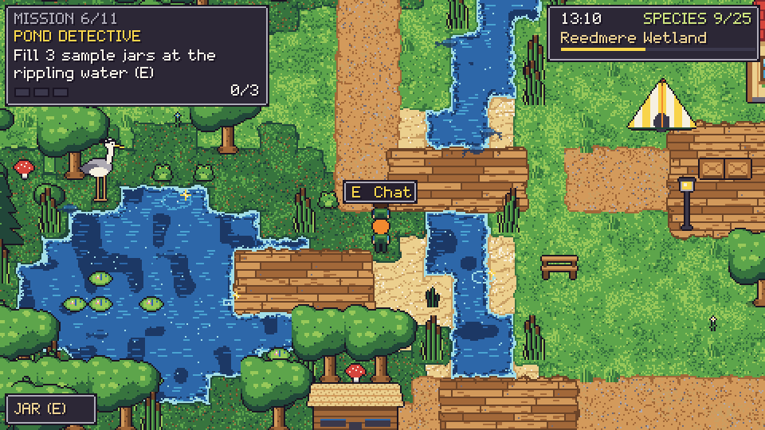
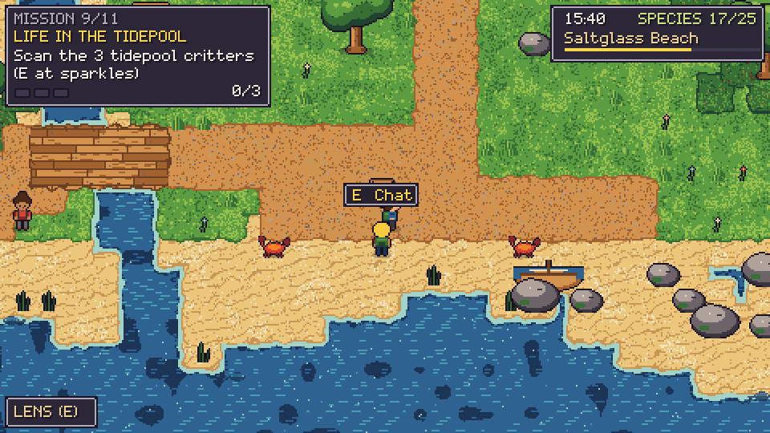
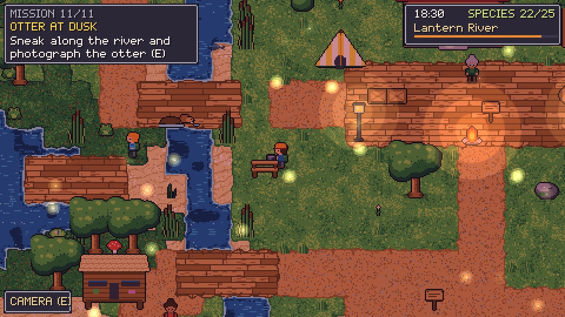
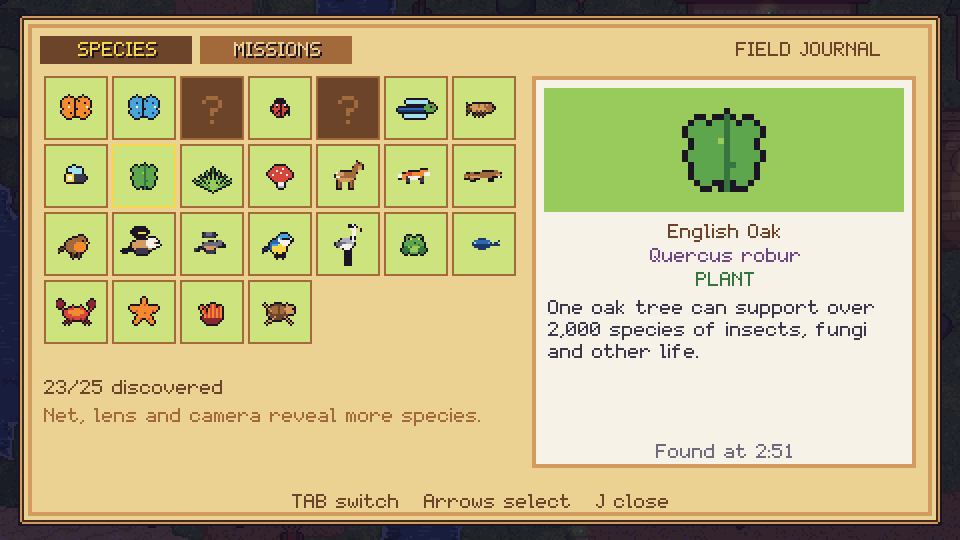
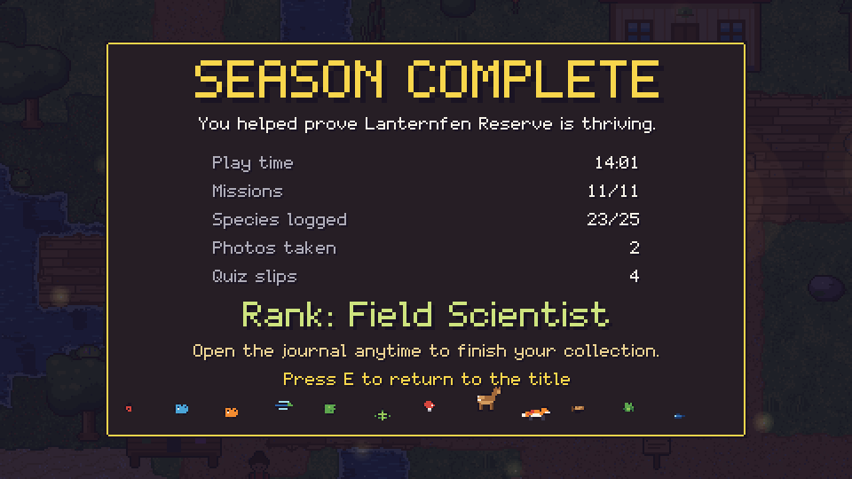

# Lanternfen Field Notes (BIOGAME)

A cozy top-down pixel-art field-science adventure for the browser. You are the new intern at **Lanternfen Reserve**.
Seven scientists (a biologist, zoologist, botanist, entomologist, freshwater biologist, ornithologist and marine
biologist) give you eleven short missions: net insects, scan fungi, stalk a deer for a photograph, follow fox tracks,
sample pond water, identify birds by their beaks, check nest boxes, survey a tidepool, guide a lost turtle hatchling
to the sea, and wait for dusk to photograph a rare otter. Every mission teaches one real biology fact, which is saved
in your **Field Journal**. Playtime is about **14 minutes** (estimate method below).

Everything is original: the setting, characters, maps, pixel art (generated in code), font and music. No assets were
downloaded, and nothing is copied from any other game.



## Run it

No build step and no dependencies. Any static file server works (the game uses ES modules, so `file://` will not):

```bash
node tools/serve.mjs 8080        # then open http://127.0.0.1:8080/
# or: python3 -m http.server 8080
```

Works in current Chromium, Firefox and Safari, desktop and phone. The 480x270 canvas is scaled by whole numbers
where possible.

## Controls

| Action | Keyboard | Touch |
|---|---|---|
| Move | WASD / arrow keys | on-screen d-pad |
| Interact / talk / net / photo / scan | E, Space or Enter | E button |
| Run (animals dislike noise) | hold Shift | RUN button |
| Field Journal (species + missions) | J (Tab switches pages) | J button |
| Pause / menu | Esc or P | II button |
| Mute | M | |

Progress is saved to `localStorage` (autosave on mission completion, every 20 s and on "Save and Quit"). Choose
**Continue** on the title screen.

## What is in it

* **World**: one 60x45-tile reserve with six zones (field station, wildflower meadow, forest, wetland with pond,
  east wood, beach with tidepools), a river with two bridges, a day/dusk light cycle, lamps and fireflies at dusk.
* **Art** (all in `src/`): 29-colour master palette, 16x16 terrain with per-pixel texture variation and automatic edge
  blending (grass, moss, sand, dirt path, wooden deck, water with foam), 8-frame water shimmer, swaying trees,
  grass, flowers and reeds, outlined characters with 6-frame walk cycles in 4 directions, idle, and net / camera /
  lens / jar tool animations, 7 NPC scientists with idle animation and 8 portrait expressions each (mouth moves
  while talking), 20+ animated animals (deer, fox and kits, otter, heron, frog, robin, blue tit, butterflies, bee, dragonfly,
  ladybird, crab, hatchling, fish, bird silhouettes...) feeding a 25-entry species journal, custom 5x7 pixel font, particles and toasts.
* **Wildlife AI**: butterflies and dragonflies flit and flee when you run; robins hop and fly off; frogs jump; herons
  take off; crabs burrow; fish scatter; the deer and otter spook if you run or get too close (sneak to photograph them).
* **Missions** (11, chained into a story): talk, read, net, scan, jar, photograph, track, bird-hide quiz mini-game,
  carry/escort, rest-until-dusk. Mini quizzes teach and re-teach each fact (wrong answers give a hint and a retry).

| # | Mission | Giver | Fact taught |
|---|---|---|---|
| 1 | Welcome to Lanternfen | Dr. Wren (ecologist) | An ecosystem is living things plus habitat |
| 2 | Meadow Specimens | Prof. Quill (entomologist) | Insects: six legs, three body parts |
| 3 | Leaf, Frond, Fungus | Dr. Sato (botanist) | Photosynthesis; fungi are not plants |
| 4 | The Shy Deer | Dr. Adeyemi (zoologist) | Prey animals have side-set eyes |
| 5 | Fox Tracks | Dr. Adeyemi | Canids cannot retract claws |
| 6 | Pond Detective | Dr. Marsh (freshwater) | Indicator species (mayfly nymphs) |
| 7 | Beaks and Feathers | Dr. Raman (ornithologist) | Beak shape matches diet |
| 8 | Nest Box Round | Dr. Raman | Clutch is incubated together, so chicks hatch together |
| 9 | Life in the Tidepool | Dr. Costa (marine) | Tides come from the Moon's gravity |
| 10 | Hatchling Rescue | Dr. Costa | Hatchlings steer to the brightest horizon |
| 11 | Otter at Dusk | Dr. Wren | Top predators indicate a healthy ecosystem |

The journal has 25 species (latin names and a fact each); two are bonus finds by scanning wildlife with E.

## Tests

One command, headless, exits non-zero on any failure:

```bash
tools/run_tests.sh
```

Stages: syntax check; "no network in game code" scan; unit tests (mission data integrity, progress, save/load and
corrupt-save rejection, quiz logic, collision invariants, deer behaviour); asset and animation checks (palette budget,
walk cycle >= 4 frames x 4 directions, frames really differ, every referenced sprite exists, autotile edges and tile
variation, colour budget); scripted autoplay in node (a bot plays the real game start to finish with 6 pacing
profiles and 8 seeds, fails on any softlock); and a headless Chromium run that boots `index.html`, drives the real
keyboard handlers, checks save/continue, plays the whole game again in the browser, fails on any console error or
exception, and writes the screenshots in `docs/screenshots/`. Needs node >= 22 and a Chromium binary (set `CHROMIUM=`
to override; `BIOGAME_SKIP_BROWSER=1` skips that stage explicitly and says so).

### Playtime estimate (method)

`tools/test_autoplay.mjs` runs a bot through the real simulation at 30 Hz. The "human" profile walks (never runs),
reads dialogue at 16 characters/s plus 0.4 s per line, thinks 6 s per quiz question and answers one in three quizzes
wrong first. Result: about 14 minutes (13:58 for the baseline, 13:58-14:59 across 9 seeds; a fast reader who runs everywhere needs
about 9; a slow reader about 20). Real players will vary with how they explore and how well they aim the net.

## Screenshots

| | | |
|---|---|---|
|  |  |  |
|  |  |  |
|  |  |  |

`art.html` is a sprite gallery (`/art.html?f=player,deer&s=4`) used for reviewing the generated art.

## Layout

```
index.html            page, canvas, touch controls
src/palette.js        the 29-colour palette
src/pixel.js          palette-indexed pixel grids, outline, rng
src/people.js         player/NPC sprites and portraits (procedural)
src/animals.js        wildlife sprites          src/props.js  scenery sprites
src/tiles.js          terrain textures + auto-tiling   src/map.js  world generator
src/data.js           scientists, species facts, missions, dialogue, quizzes
src/logic.js          pure progress / save / clock logic
src/core.js           simulation (player, AI, mission engine)   src/bot.js  autoplay bot
src/render.js, gfx.js canvas renderer, UI, pixel font drawing    src/font.js 5x7 font
src/audio.js          WebAudio SFX + generative music (no files)
tools/                tests, serve.mjs, cdp.mjs (headless Chromium driver without npm packages)
```

## Credits

All code, pixel art, font, story and sound are original work for this project. Biology facts were written to be
accurate at a general-audience level. Licence: MIT.
